# The GW viewing angle: $p(d_L, \theta_\mathrm{v})$

How each realisation of the emission-model limit gets its viewing angle, and the checks behind it.
Notebook: [`2_gw_viewing_angle.ipynb`](../notebooks/2_gw_viewing_angle.ipynb). Code:
[`gwuls/gw_pe.py`](../gwuls/gw_pe.py) (PE files) and
[`gwuls/angle_distribution.py`](../gwuls/angle_distribution.py) (the distributions). Numbers are for
**S240615dg** (GW240615_113620, GWTC-5.0), a binary black hole: no jet is expected, it is used
because its PE is public and its inclination sharply measured. The method is the same for a BNS or
NSBH.

**Contents**

1. [Where this sits in the pipeline](#1-where-this-sits-in-the-pipeline)
2. [Geometry: from $\theta_{JN}$ to the jet viewing angle](#2-geometry-from-theta_jn-to-the-jet-viewing-angle)
3. [Why distance and angle must be drawn together](#3-why-distance-and-angle-must-be-drawn-together)
4. [Joint, conditionals and marginals](#4-joint-conditionals-and-marginals)
5. [PE data: raw release to a light per-alert file](#5-pe-data-raw-release-to-a-light-per-alert-file)
6. [Estimating the joint from samples](#6-estimating-the-joint-from-samples)
7. [Results for S240615dg](#7-results-for-s240615dg)
8. [The alert skymap and the PE disagree on distance](#8-the-alert-skymap-and-the-pe-disagree-on-distance)
9. [Without PE: population and placeholder options](#9-without-pe-population-and-placeholder-options)
10. [Where the choice reaches the upper limit](#10-where-the-choice-reaches-the-upper-limit)
11. [How `3_upper_limits` uses the result](#11-how-3_upper_limits-uses-the-result)
12. [Caveats](#12-caveats)
13. [References](#13-references)

---

## 1. Where this sits in the pipeline

Every realisation of the emission-model limit draws one possible source (guidelines Step 4):

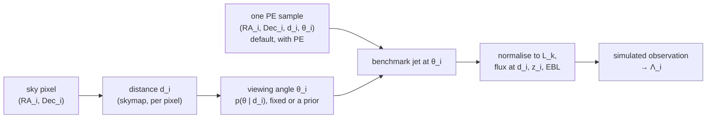

With released PE, all four values come from one posterior sample (top path, §11). The lower path,
the skymap route, is the fallback without PE. The notebook prepares both: Part 0 writes the
standardized PE samples (`data/gw_pe/standardized/<alert>.h5`) that the default draw reads, and the
end of the notebook saves one $p(\theta_\mathrm{v} \mid d)$ to
`data/gw_input/<alert>_theta_distribution.npz` for the other options.

---

## 2. Geometry: from $\theta_{JN}$ to the jet viewing angle

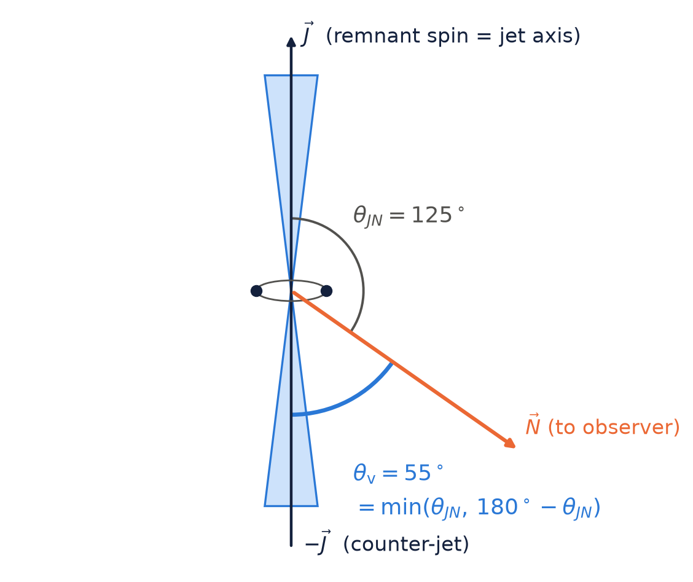

PE reports two inclinations from the line of sight $\vec N$, both in $[0^\circ, 180^\circ]$:
$\theta_{JN}$ to the **total** angular momentum $\vec J$ (fixed in direction, even for a precessing
binary) and $\iota$ to the **orbital** angular momentum at $f_\mathrm{ref}$ (precesses around
$\vec J$). The jet is launched along the remnant spin, essentially $\vec J$, so $\theta_{JN}$ is the
right angle. The jet is bipolar, so what matters is the angle to the **nearer** axis:

$$
\theta_\mathrm{v} = \min\left(\theta_{JN},\ 180^\circ - \theta_{JN}\right) \in [0^\circ, 90^\circ].
$$

This matches pesummary's `viewing_angle` column to $4\times10^{-15}$ deg (notebook Part 0). With no
information, $\cos\theta_\mathrm{v}$ is uniform on $[0, 1]$:
$p_\mathrm{iso}(\theta_\mathrm{v}) = (\pi/180)\sin\theta_\mathrm{v}$ per degree, which vanishes
face-on because small angles occupy little solid angle. **Every pdf here and in the code is per
degree.**

---

## 3. Why distance and angle must be drawn together

To leading order the two polarisations of an inspiral are

$$
h_+ = \frac{\mathcal{A}}{d_L}\,\frac{1 + \cos^2\iota}{2}\,\cos\Phi(t),
\qquad
h_\times = \frac{\mathcal{A}}{d_L}\,\cos\iota\,\sin\Phi(t),
$$

and a detector with antenna patterns $F_{+,\times}$ measures an SNR (Finn & Chernoff 1993)

$$
\rho = \rho_\mathrm{th}\,\frac{D_h}{d_L}\,\frac{\Theta}{4},
\qquad
\Theta = 2\sqrt{F_+^2\,(1 + \cos^2\iota)^2 + 4F_\times^2\cos^2\iota}\ \in [0, 4],
$$

with $D_h$ the **horizon** of an optimally located, face-on source. The data constrain mostly
$\Theta(\iota)/d_L$: **a face-on source far away looks like an inclined one nearby**. So the angle of
a realisation must depend on its distance. For S240615dg, $\mathrm{corr}(d_L, \cos\theta_\mathrm{v}) = 0.82$.

---

## 4. Joint, conditionals and marginals

Everything follows from the joint $p(d, \theta)$ ($d \equiv d_L$, $\theta \equiv \theta_\mathrm{v}$). What
each realisation needs is the **conditional** $p(\theta \mid d) = p(d, \theta)/p(d)$:

| question | operation | method |
| --- | --- | --- |
| $\theta_i$ given a drawn $d_i$ | $p(\theta \mid d_i)$ | `ThetaDistribution.sample(n, distance_Mpc=d)` |
| distance if the angle is known | $p(d \mid \theta_0)$, or $\propto \int_a^b p(d, \theta)\,d\theta$ for a range | `joint.conditional_distance(theta_deg=θ0)` / `(theta_range=(a, b))` |
| one variable alone | $p(d)$, $p(\theta)$ | `joint.marginal_distance()`, `joint.marginal_theta()` |
| (RA, Dec, $d$, $\theta$) together | resample PE sample indices | `ThetaDistribution.sample_joint(n)` |

Which joint exists depends on what LVK has released:

| information | `kind` | $\theta$ depends on $d$? | section |
| --- | --- | --- | --- |
| PE posterior samples (GWTC release) | `"pe"` | yes, the event's own posterior | §5–§8 |
| detected population with a horizon | `"selection"` | yes, near $D_h$ only face-on sources | §9 |
| Schutz (2011), isotropic, fixed, two_bin | `"schutz"`, `"isotropic"`, `"fixed"`, `"two_bin"` | no | §9 |

---

## 5. PE data: raw release to a light per-alert file

### 5.1 The raw release

A GWTC `*-combined_PEDataRelease.hdf5` (Zenodo) holds several waveform analyses per event (for
GWTC-5.0: IMRPhenomXPHM-SpinTaylor, IMRPhenomXPNR, NRSur7dq4, SEOBNRv5PHM), each with ~12–16k
posterior samples of ~180 parameters plus PSDs, priors and a skymap: 6.6 GB for S240615dg. Raw
files go in `data/gw_pe/raw/` (gitignored) with the catalogue's `*-PESummaryTable.hdf5`, which
maps GWTC names to superevent IDs. The priors are `UniformSourceFrame` for $d_L$ and isotropic for
$\theta_{JN}$; the posterior, prior included, is what the simulation should draw from, so nothing
is reweighted.

### 5.2 Equal-weight mixture

Catalogue papers combine analyses with equal weight, $p_\mathrm{mix} = \frac{1}{K}\sum_k p_k$, to fold
in waveform systematics. Drawing the same number of samples from each analysis (5000 by default,
capped at the smallest) and concatenating them gives samples of $p_\mathrm{mix}$ directly.

### 5.3 The standardized file

`gw_pe.standardize_pe_release` (or `standardize_all`) writes
`data/gw_pe/standardized/<superevent>.h5`, ~0.85 MB and **tracked in git**: provenance attributes;
`posterior/` with sky position, distance, redshift, $\theta_{JN}$, $\iota$, masses, $\chi_\mathrm{eff}$,
tidal parameters when present, network SNR and the source analysis of each sample; `prior/` samples
of $d_L$ and $\theta_{JN}$; and per-analysis metadata. A column is kept only if every analysis has it.
Files are named by **superevent ID**, like the skymap in `data/gw_input/`. `index.csv` lists every
standardized alert:

| alert | GW name | $d_L$ [Mpc] (median, 90%) | $\theta_\mathrm{v}$ [deg] (median, 90%) | $P(\theta_\mathrm{v} < 30^\circ)$ | $m_1, m_2$ [$M_\odot$] |
| --- | --- | --- | --- | --- | --- |
| S240615dg | GW240615_113620 | 1566 [1123, 1849] | 24.4 [6.5, 51.1] | 0.647 | 34.1, 26.0 |
| S241125n | GW241125_010116 | 4748 [2600, 8611] | 55.8 [15.6, 86.0] | 0.168 | 59.3, 46.1 |

Without the raw files (e.g. on the cluster) the notebook just reads these.

### 5.4 Check: the light file loses nothing

Per analysis, the 5/50/95% quantiles of the 5000 kept samples match the full posterior to within
~1° in $\theta_\mathrm{v}$ and ~15 Mpc in $d_L$: subsampling noise.

---

## 6. Estimating the joint from samples

`3_upper_limits` may need the conditional at any $d_i$, so the notebook builds a smooth density on
a grid with a Gaussian KDE, `JointDistanceAngle.from_samples`:

- **Variables $(d, \cos\theta_\mathrm{v})$.** Per degree the density vanishes linearly at
  $\theta_\mathrm{v} = 0$, and a KDE in $\theta$ would smear mass onto the edge. In
  $c = \cos\theta_\mathrm{v}$ it is finite and smooth, and maps back as
  $p(d, \theta_\mathrm{v}) = \hat f(d, c)\,\sin\theta_\mathrm{v}\,\pi/180$.
- **Full-covariance kernel** (Scott's rule), $H = b^2\,n_\mathrm{eff}^{-1/3}\,\hat\Sigma$ with $b$ =
  `BW_SCALE`. It carries the samples' correlation, so the kernel is tilted along the degeneracy
  instead of blurring across it.
- **Exact reflection** at $c = 0$, $c = 1$ and $d = 0$: each mirrored sample is smoothed with the
  mirrored kernel $RHR$ (correlation flipped), so mass pushed past an edge comes back with the
  right tilt.
- **Grid**: $300 \times 400$ in $(d, c)$, FFT convolution, interpolated to 181 angles (0.5°) and
  normalised; ~0.4 s for 20 000 samples. The distance support is where $p(d) > 10^{-6}$ of its
  peak ([380, 2352] Mpc for S240615dg); requests outside are clamped, with a warning.
- **Conditionals**: linear interpolation between grid rows, then inverse-CDF sampling, vectorised
  (100 000 draws at their own $d_i$ in ~0.1 s). $p(d \mid \theta)$ comes from the columns.

---

## 7. Results for S240615dg

### 7.1 The joint posterior

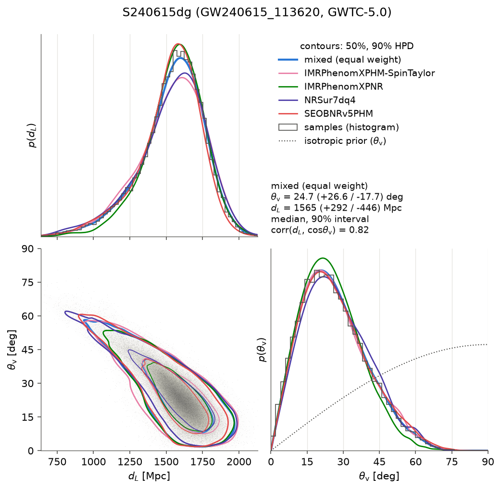

The four waveform analyses agree closely ($\theta_\mathrm{v}$ medians 23.9°–25.9°, $d_L$ medians
1553–1576 Mpc), so mixing them costs nothing. The mixed KDE gives $\theta_\mathrm{v}$ =
24.7 [7.0, 51.3]° and $d_L$ = 1565 [1120, 1858] Mpc: far from the isotropic prior (median 60°),
with 64% of the probability within 30° of the jet axis.

### 7.2 $p(\theta_\mathrm{v} \mid d)$ along $d$

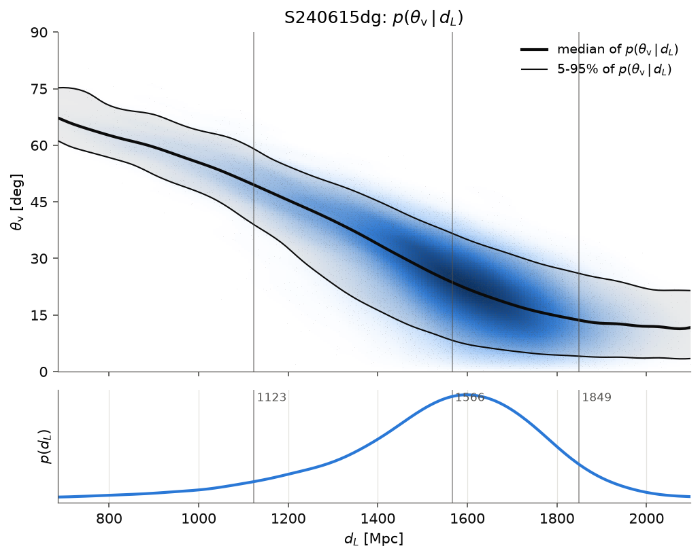

The conditional median falls from **49.5° at 1123 Mpc** (5th percentile of $p(d)$) to **13.6° at
1849 Mpc** (95th). Drawing $\theta$ from the marginal instead would pair far distances with inclined
angles, which the data exclude.

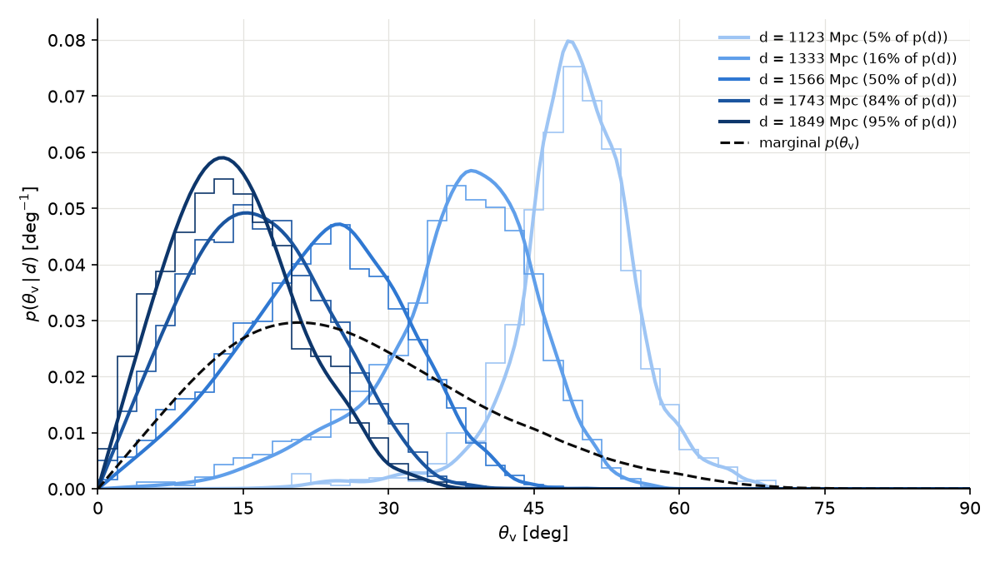

| $d$ (Mpc) | percentile | grid: median [90%] | grid-free resampling | $b = 0.5$ / $2$ medians |
| --- | --- | --- | --- | --- |
| 1123 | 5% | 49.5 [38.9, 59.0] | 49.3 [37.4, 59.4] | 49.5 / 49.1 |
| 1333 | 16% | 38.1 [20.6, 48.5] | 37.8 [19.4, 48.6] | 38.2 / 37.7 |
| 1566 | 50% | 23.7 [8.3, 36.6] | 23.3 [7.5, 36.7] | 23.5 / 24.5 |
| 1743 | 84% | 16.3 [4.9, 29.3] | 16.2 [4.5, 29.5] | 16.0 / 17.1 |
| 1849 | 95% | 13.6 [4.1, 26.0] | 13.6 [3.7, 26.4] | 13.2 / 15.1 |

Two checks: the grid agrees with a grid-free estimate (`conditional_theta_by_resampling`, Gaussian
weights in $d$) to within 0.5°, and halving or doubling the bandwidth moves the medians by at most
1.5°, far less than their 90% widths.

### 7.3 "The angle is known": $p(d_L \mid \theta_\mathrm{v})$

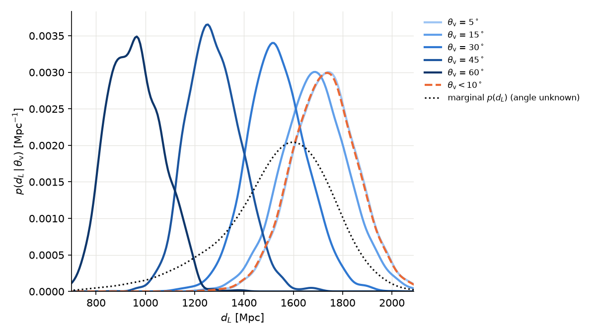

If the angle were known independently (an EM light curve, or by assumption), the distance to use is
the joint conditioned on it: median 1729 Mpc at 5°, 1530 at 30°, 953 at 60°, and 1726 [1502, 1950]
Mpc for $\theta_\mathrm{v} < 10^\circ$, against 1565 [1120, 1858] with the angle unknown. Angles deep
in the tail of $p(\theta)$ rest on few samples.

### 7.4 Check: every sampling route returns the posterior

| route | $\theta_\mathrm{v}$ q5/50/95 | $d_L$ q5/50/95 | corr$(d, \cos\theta)$ | KS($\theta$) vs PE |
| --- | --- | --- | --- | --- |
| PE samples | 6.5 / 24.4 / 51.1 | 1123 / 1566 / 1849 | 0.824 | 0 |
| 1. $d \sim p(d)$, then $\theta \sim p(\theta \mid d)$ (grid) | 7.0 / 24.7 / 51.3 | 1122 / 1566 / 1857 | 0.820 | 0.012 |
| 2. grid $\theta \mid d_k$ at each sample's own $d$ | 7.1 / 24.6 / 51.0 | 1123 / 1566 / 1849 | 0.819 | 0.016 |
| 3. `sample_joint` (resampled PE indices) | 6.5 / 24.4 / 51.1 | 1125 / 1565 / 1847 | 0.823 | 0.002 |

The small shift of the lowest angles in routes 1–2 is KDE smoothing at the face-on edge. Route 3,
the default of `3_upper_limits`, involves no density estimate.

---

## 8. The alert skymap and the PE disagree on distance

The skymap route draws $d_i$ from the **alert skymap**, whose pixels carry the Singer et al. (2016)
distance ansatz, and $\theta_i$ from the **PE** conditional. That gives

$$
p_\mathrm{route}(\theta) = \int p_\mathrm{sky}(d)\;p_\mathrm{PE}(\theta \mid d)\;dd
\ \neq\ p_\mathrm{PE}(\theta)\quad\text{unless}\quad p_\mathrm{sky}(d) = p_\mathrm{PE}(d).
$$

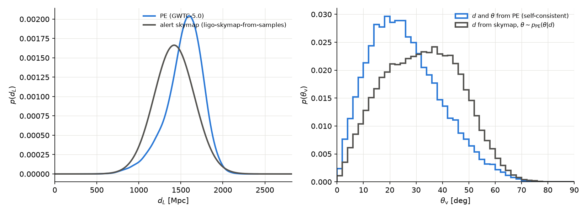

For S240615dg the alert skymap (from the online PE) puts the source at **1421 [1028, 1815] Mpc**,
nearer than the final GWTC-5.0 PE (1566 [1123, 1849] Mpc). Nearer means more inclined, so the
skymap route draws a $\theta_\mathrm{v}$ median of **32.6°** instead of 24.4°: a **+8.2° bias**.

So with released PE, sky position, distance and angle are drawn **together** from one PE sample
(the guidelines' "best option", replacing Steps 4.1–4.3). This is the default
(`SKY_DISTANCE_MODE = THETA_MODE = "pe"`, §11). The notebook warns whenever the shift exceeds 2°.

### 8.1 The second shortcut: one $p(\theta \mid d)$ for the whole sky

Drawing a pixel, then $d$ in it, then $\theta$ from $p(\theta \mid d, \Omega)$ would be exact. The
grid of §6 is instead the sky-averaged $p(\theta \mid d)$, which assumes $\theta$ is independent of
the sky position $\Omega$ at fixed $d$. Physically it is not: the antenna patterns change across the
sky, and where the network sees both polarisations the ratio
$h_\times/h_+ \propto 2\cos\iota/(1+\cos^2\iota)$ pins the angle, where it sees one it does not.

The PE samples carry their own (RA, Dec, $d$, $\theta_{JN}$), so this can be measured
(`angle_distribution.sky_dependence_check`). The samples are split into $K$ sky regions (k-means on
the sphere). In each region the region's own samples (exact) are compared with all samples
reweighted to the region's distances (the shortcut). Two noise references: region labels permuted
within distance bins, and a PIT test, $u_k = F(\theta_k \mid d_k)$ uniform in every region.
Random labels give null results.

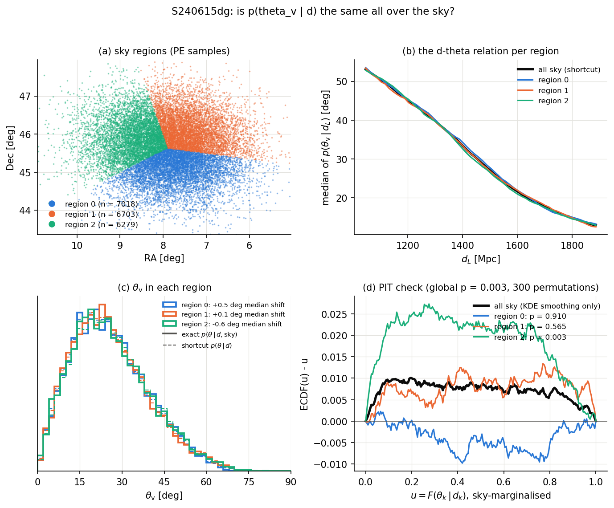

**S240615dg** (a few deg², 3 regions): median shifts of +0.5°, +0.1°, −0.6° (null sd 0.1°) and at most
0.02 in $P(\theta_\mathrm{v} < 20^\circ)$. Detectable with 20 000 samples, practically irrelevant.

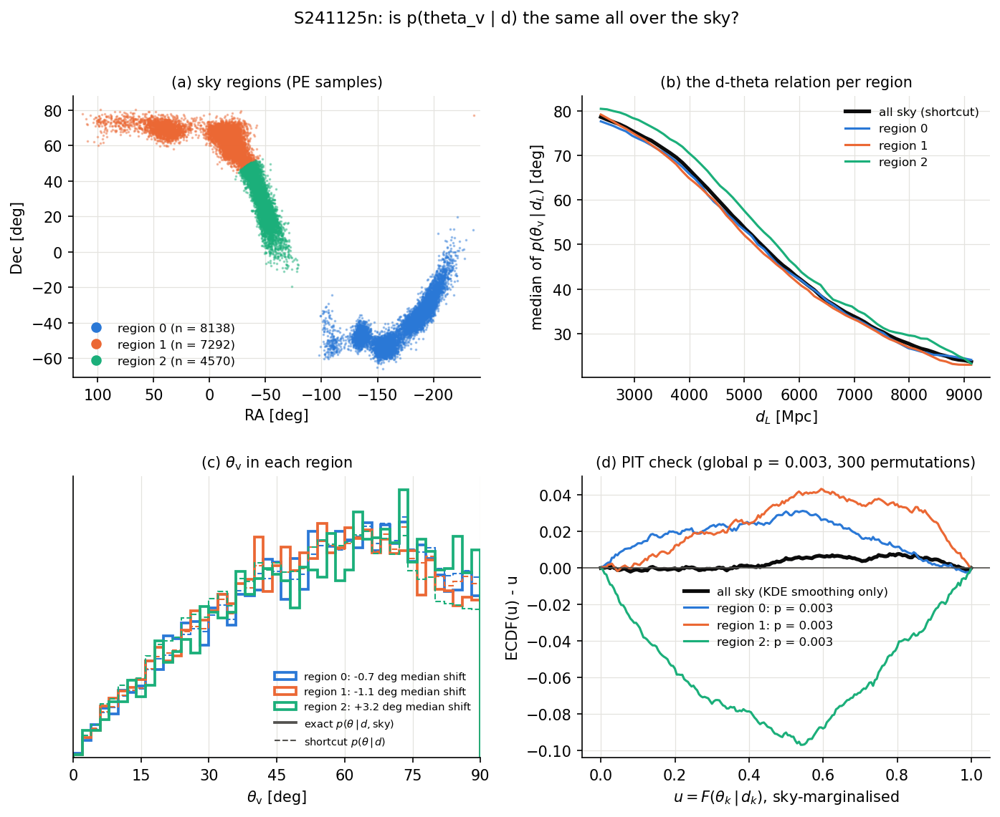

**S241125n** (two arcs over thousands of deg²): shifts up to +3.2° with 3 regions and ±6.5° with 4
(null sd 0.2–0.3°), and the on-axis probability off by −30% and +37% in two regions.

**Consequence.** Over the whole sky the shortcut averages out (route 2 of §7.4), but it is biased
region by region, and the IACT covers only part of the localisation. For a broad localisation the
angles in the observed pixels can be off by several degrees. The joint PE draw removes the issue.
To size it for one observation, pass `regions` = inside/outside the pointings to
`sky_dependence_check`. Without PE no per-pixel angle information exists.

---

## 9. Without PE: population and placeholder options

A low-latency skymap carries no inclination. The options:

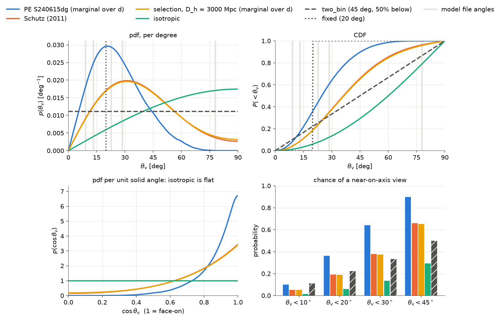

| option | median | $P(<10^\circ)$ | $P(<20^\circ)$ | $P(<30^\circ)$ |
| --- | --- | --- | --- | --- |
| PE S240615dg (marginal over $d$), for comparison | 24.7 | 0.101 | 0.362 | 0.641 |
| Schutz (2011) | 36.2 | 0.051 | 0.190 | 0.378 |
| selection, $D_h = 3000$ Mpc (marginal) | 36.5 | 0.051 | 0.188 | 0.374 |
| isotropic | 60.0 | 0.015 | 0.060 | 0.134 |
| two_bin (45°, 50%) | 45.0 | 0.111 | 0.222 | 0.333 |
| fixed (20°) | 20.0 | 0 | 0 | 1 |

### 9.1 Isotropic

$p(\theta) = (\pi/180)\sin\theta$: no GW selection, the most pessimistic choice for an on-axis
counterpart.

### 9.2 GW selection: the "selection" model and Schutz

Face-on binaries are louder, so detected sources favour them. With sources uniform in volume and
isotropic, detected when $\Theta/4 > d/D_h$ (§3), and the antenna pattern of one detector averaged
over sky and polarisation, the detected population is

$$
p(d, \theta) \propto d^2\,\sin\theta\;P_\mathrm{det}\!\left(\frac{d}{D_h}, \theta\right),
\qquad 0 < d < D_h,
\qquad
p(\theta) \propto \sin\theta\,\left\langle(\Theta/4)^3\right\rangle .
$$

Schutz (2011, Eq. 28) replaces $\langle\Theta^3\rangle$ by $\langle\Theta^2\rangle^{3/2}$, which gives the
closed form of the guidelines,

$$
p_\mathrm{Schutz}(\theta) \propto \sin\theta\,\left[\frac{(1 + \cos^2\theta)^2}{4} + \cos^2\theta\right]^{3/2}.
$$

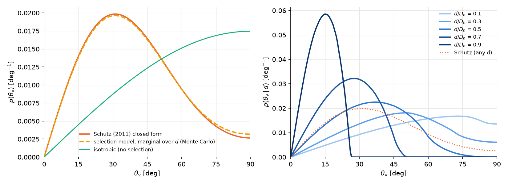

The two marginals agree to 0.009 in CDF (medians 36.5° and 36.2°). What Schutz throws away is the
distance (right panel): the `"selection"` model's $p(\theta \mid d)$ has median 58° at $d/D_h = 0.1$
and 14° at 0.9, the population-level version of the degeneracy. It needs a horizon $D_h$ for the
source type and network, which the alert does not give (`HORIZON_MPC = 3000` is illustrative).

Approximations behind Schutz, and what they cost:

- **Threshold on the polarisation-averaged SNR** ($\langle\Theta^3\rangle \to \langle\Theta^2\rangle^{3/2}$):
  negligible, per the check above.
- **Inclination separable from sky position:** exact for the all-sky marginal, lost per pixel
  (§8.1).
- **Marginal over distance:** large once $d_i$ is drawn; `"selection"` keeps it.
- **Euclidean volume:** a sub-Euclidean rate $\propto d^p$ weakens the face-on bias (median 36.5° /
  39.1° / 42.2° for $p$ = 2 / 1.5 / 1, `selection_joint(distance_power=p)`). Matters for distant BBH.
- **Sharp threshold, quadrupole only, GW selection only:** second order for near-equal-mass BNS;
  EM-triggered or early-warning selection would change the population.

**Schutz is a population prior, not an event posterior.** It must not be combined with a PE
posterior: a single event's posterior with the isotropic prior already describes the detected
source, so multiplying by Schutz counts the face-on bias twice. Nissanke et al. (2010) find the same
bias in a full network Monte Carlo.

### 9.3 Placeholders

- **`fixed`**: $\theta_i = \theta_0$ in every realisation.
- **`two_bin`**: mass $p_<$ uniform below $\theta_t$, the rest uniform above (default 45°, 50%). No
  claim about the shape.

Each option's sampler matches its own pdf at the $1/\sqrt{n}$ noise level (200k draws):

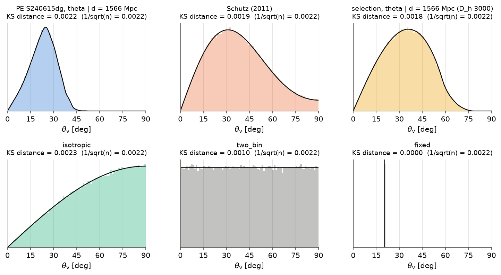

---

## 10. Where the choice reaches the upper limit

The benchmark jet is tabulated every 1°, and its light curve changes continuously with angle:
the peak moves from seconds on-axis to $7\times10^4$ s at 50°, and at 11 h the flux is $10^{-5}$ of
the on-axis value at 50° ([`emission_model.md`](emission_model.md) §4). Under the default
normalisation (`"gti_mean"`) only the **shape** reaches the limit: where the observation falls on
the light curve, and so how the runs are weighted. Under `"anchor"` the faintness off-axis enters
too, and the angle distribution then dominates the limit
([`pipeline.md`](pipeline.md) §11.2). Either way, the far off-axis tail of $p(\theta_\mathrm{v})$
is what separates the options: the isotropic prior puts 60% of the draws above 53°, Schutz 22%,
and the S240615dg PE 4%.

---

## 11. How `3_upper_limits` uses the result

Two options of `simulate.EmissionModelInjection` set the draw, and `simulate.sample_injections_3d`
performs it:

| notebook option | values |
| --- | --- |
| `SKY_DISTANCE_MODE` | `"pe"` (default): (RA, Dec, $d$) of one PE sample per realisation (`simulate.sample_sky_distance_angle_pe`); `"skymap"`: a skymap bin and $d_i$ from its distance ansatz |
| `THETA_MODE` | `"pe"` (default): $\theta$ of the same PE sample, the exact joint (needs `"pe"` above); `"gw"`: $p(\theta \mid d_i)$ from the saved cache; `"fixed"`, `"isotropic"`, `"schutz"`, `"two_bin"`, `"selection"`: §9 |

With `"pe"`, samples outside the analysis geometry (or the 95% mask) are dropped, which conditions
the posterior on the sky support, and the source is injected at the centre of the bin its sample
falls in. The calls underneath:

```python
from gwuls import angle_distribution as angdist, paths

theta_dist = angdist.load_theta_distribution(paths.theta_distribution_path(source_name))
theta_i = theta_dist.sample(N, distance_Mpc=d_draws, rng=rng)   # p(theta | d_i), one per d_i
draw = theta_dist.sample_joint(N, rng=rng)                      # (RA, Dec, d, theta) of one PE sample
d, p_d = theta_dist.joint.conditional_distance(theta_deg=20.0)  # the distance if the angle were known
```

**A new alert with PE:** put its `*-combined_PEDataRelease.hdf5` (and the catalogue's
`*-PESummaryTable.hdf5`) in `data/gw_pe/raw/`, set `source_name` to the superevent ID, run the
notebook, and commit `data/gw_pe/standardized/`.

---

## 12. Caveats

- **Jet along $\vec J$.** Standard for BNS/NSBH, but an assumption.
- **Source class.** S240615dg is a BBH, a worked example; a BNS or NSBH enters the same way.
- **KDE tails.** Conditionals deep in the tails rest on few samples; the notebook prints
  $P(\theta < \theta_0)$ next to every $p(d \mid \theta_0)$.
- **Skymap routes.** Skymap distances with the PE conditional bias the angle (§8), and the
  sky-averaged $p(\theta \mid d)$ is biased per region for broad localisations (§8.1). The default
  joint PE draw avoids both; `THETA_MODE = "gw"` does not.
- **Selection model.** One detector, sky- and polarisation-averaged, sharp threshold, and an
  illustrative horizon.
- **Power-law 3D limit still uses the skymap**, so it and the emission-model limit do not share
  their sky and distance draws.
- **Test statistic.** $\Lambda$ still weights by the skymap $p_\mathrm{GW}$ the data were analysed
  with; only the injected population follows the PE.

---

## 13. References

- L. S. Finn and D. F. Chernoff, *Observing binary inspiral in gravitational radiation: one
  interferometer*, Phys. Rev. D **47**, 2198 (1993), [arXiv:gr-qc/9301003](https://arxiv.org/abs/gr-qc/9301003):
  the orientation factor $\Theta$.
- B. F. Schutz, *Networks of gravitational wave detectors and three figures of merit*, Class.
  Quantum Grav. **28**, 125023 (2011), [arXiv:1102.5421](https://arxiv.org/abs/1102.5421):
  the detected-source inclination distribution (Eq. 28) and its derivation from the
  polarisation-averaged network antenna pattern (Sections 2.1–2.5).
- S. Nissanke, D. E. Holz, S. A. Hughes, N. Dalal and J. L. Sievers, *Exploring short
  gamma-ray bursts as gravitational-wave standard sirens*, ApJ **725**, 496 (2010),
  [arXiv:0904.1017](https://arxiv.org/abs/0904.1017): Monte Carlo of the detected
  $(d_L, \cos\iota)$ distribution (their Fig. 3), the distance–inclination degeneracy.
- L. P. Singer et al., *Going the distance: mapping host galaxies of LIGO and Virgo sources
  in three dimensions using local cosmography and targeted follow-up*, ApJL **829**, L15
  (2016), [arXiv:1603.07333](https://arxiv.org/abs/1603.07333): the per-pixel distance ansatz of
  the skymaps.
- D. W. Scott, *Multivariate Density Estimation: Theory, Practice, and Visualization* (Wiley,
  1992): the bandwidth rule.
- LVK, GWTC-5.0 parameter-estimation data release (Zenodo): the `combined_PEDataRelease` and
  `PESummaryTable` files.
